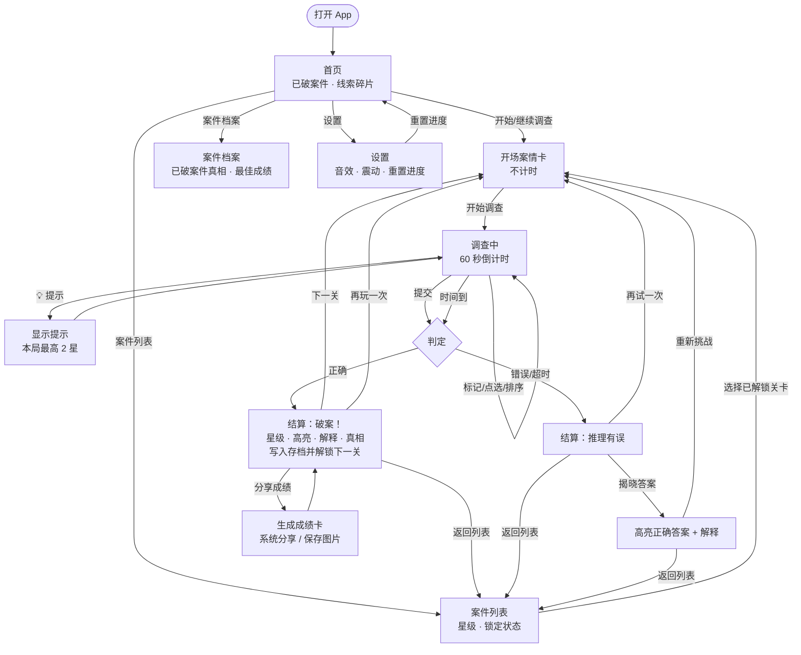

# 《一分钟谜案》设计文档（MVP）

> 竖屏 · 离线 · 单局 60 秒 · 观察 + 推理 + 点选
> 传播文案：**你能 60 秒看出谁在说谎吗？**

本文档包含三部分：

1. [关卡数据 JSON 结构](#1-关卡数据-json-结构)
2. [第一关完整设计样例《雨夜访客》](#2-第一关完整设计样例雨夜访客)
3. [MVP 页面流程图](#3-mvp-页面流程图)

最后附 [原型实现现状与下一步](#4-原型现状与下一步)。

---

## 1. 关卡数据 JSON 结构

### 1.1 设计原则

- **一关一个 JSON 文件**，放在 `levels/`，图片放在 `levels/assets/`。
- **内容与引擎分离**：引擎只认识 3 种交互（标记热区、点选条目、拖拽排序），5 种关卡类型都由这 3 种交互组合出来。新增关卡 = 写 JSON + 画图，不改代码。
- **可校验**：`npm run validate` 会检查所有关卡（必填字段、答案 id 是否存在、热区是否越界/重叠、排序初始顺序是否等于答案等）。这是后续关卡编辑器的基础。

| 关卡类型（category） | 交互（content.kind） | 答案（answer.kind） |
| --- | --- | --- |
| `item` 物品不合理 | `scene` 场景图 | `hotspots` 热区 |
| `timeline` 时间线矛盾 | `testimony` 监控 + 证词 | `pick` 点选 |
| `testimony` 证词冲突 | `testimony` 或 `scene` | `pick` / `hotspots` |
| `chat` 聊天记录找谎 | `chat` 聊天截图 | `pick` 点选 |
| `order` 排序推理 | `order` 事件卡片 | `order` 顺序 |

`category` 决定展示的标签和关卡分组，`content.kind` 决定用哪种交互，两者独立——比如“时间线矛盾”以后也可以做成在监控截图上标热区。

### 1.2 关卡清单 `levels/index.json`

```json
{
  "version": 1,
  "levels": ["case-001", "case-002", "case-003", "case-004"]
}
```

数组顺序 = 关卡顺序 = 解锁顺序（破解上一关解锁下一关）。

### 1.3 公共字段

```jsonc
{
  "id": "case-001",          // 与文件名一致，存档按此 id 记录
  "version": 1,              // 关卡改版时 +1，便于以后迁移存档/统计
  "title": "雨夜访客",
  "category": "item",        // timeline | item | testimony | chat | order
  "difficulty": 1,           // 1–3
  "timeLimit": 60,           // 秒，≥ 20
  "brief": "一句话案情……",     // 开场卡片与关卡顶部展示
  "question": "找出 2 处破绽……", // 明确告诉玩家要找几处、找什么
  "hint": "提示文本",          // 使用后本局最高 2 星（之后可接激励广告）
  "content": { "kind": "..." },// 见 1.4
  "answer":  { "kind": "..." },// 见 1.4
  "summary": "真相总结"         // 结算页与“案件档案”展示
}
```

### 1.4 三种交互的 content / answer

#### A. 场景找茬 `scene` + `hotspots`

```jsonc
"content": {
  "kind": "scene",
  "image": "assets/case-001.svg", // SVG 或 PNG/WebP，相对 levels/
  "width": 360,                   // 场景坐标系，热区坐标都基于它
  "height": 480
},
"answer": {
  "kind": "hotspots",
  "maxMarks": 2,                  // 玩家最多可放的标记数 = 热区数量
  "hotspots": [
    {
      "id": "umbrella",
      "shape": "circle",          // circle: x,y,r   rect: x,y,w,h
      "x": 176, "y": 246, "r": 42,
      "label": "挂着蛛网的雨伞",    // 揭晓时标在图上
      "explain": "一句解释"         // 结算页逐条展示
    }
  ]
}
```

判定：每个热区内至少有 1 个标记，且没有落在热区外的标记 → 正确。

#### B. 点选条目 `chat` / `testimony` + `pick`

聊天记录：

```jsonc
"content": {
  "kind": "chat",
  "group": "市场部（6）",
  "date": "周一 09:05",
  "messages": [
    { "id": "m1", "from": "组长", "time": "09:05", "text": "……" }
  ]
},
"answer": {
  "kind": "pick",
  "maxPicks": 2,
  "ids": ["m2", "m7"],                         // 与顺序无关
  "explain": { "m2": "……", "m7": "……" }
}
```

监控/证词对照（只有 `selectable: true` 的分组可以点）：

```jsonc
"content": {
  "kind": "testimony",
  "sections": [
    { "title": "门口监控记录", "style": "log",   "selectable": false,
      "items": [{ "id": "c1", "time": "21:58", "text": "店长 离店" }] },
    { "title": "证词",         "style": "quote", "selectable": true,
      "items": [{ "id": "t1", "who": "店长", "text": "……" }] }
  ]
}
```

判定：选中集合与 `ids` 完全一致 → 正确。

#### C. 排序推理 `order` + `order`

```jsonc
"content": {
  "kind": "order",
  "items": [{ "id": "e1", "text": "……" }],
  "initialOrder": ["e4", "e1", "e6", "e3", "e5", "e2"] // 固定打乱顺序，保证每个玩家开局一致
},
"answer": { "kind": "order", "sequence": ["e1", "e2", "e3", "e4", "e5", "e6"] }
```

判定：顺序完全一致 → 正确；揭晓时标出玩家放错位置的卡片。

### 1.5 评分与存档

- 星级：答对时剩余 ≥ 50% 时间 3 星，≥ 1/6 时间 2 星，否则 1 星；用过提示最多 2 星；答错/超时 0 星。
- 星星即“线索碎片”，首页显示总数。
- 本地存档（`localStorage` 键 `yfmz.save.v1`）：

```json
{
  "levels": { "case-001": { "stars": 3, "bestRemaining": 41, "attempts": 2 } },
  "settings": { "sound": true, "vibrate": true }
}
```

### 1.6 关卡制作规范（写给内容作者）

1. **一关只考一个“啊哈”点**：破绽要能用一句话解释清楚。
2. **题干要说清找几处**：“找出 2 处”比“找出破绽”体验好得多。
3. **给出对照物**：只画一双干鞋看不出问题；画一只湿漉漉的狗和一串湿脚印，干鞋才显眼。
4. **热区宁大勿小**：手机上半径 ≥ 24（场景坐标 360 宽时），两个热区不要重叠。
5. **干扰项要合理**：热茶、挂钟、相框都可能被怀疑，但都经得起推敲。
6. 写完运行 `npm run validate`，再自己限时玩一遍。

---

## 2. 第一关完整设计样例《雨夜访客》

| 项目 | 内容 |
| --- | --- |
| 编号 / 类型 | case-001 · 物品不合理（场景找茬） |
| 难度 / 时限 | ◆ · 60 秒 |
| 教学目标 | 学会：看图 → 对照证词 → 点击标记 → 提交；理解“对照物”思路 |

### 2.1 案情

> 暴雨夜，林女士报警说家里进了贼。她坚称：“我刚冒着大雨从外面赶回来，一进门就发现屋里被翻过了。”
>
> 🔍 在玄关找出 2 处破绽，证明她今晚根本没出过门

### 2.2 场景构成（360 × 480）

| 元素 | 位置 | 作用 |
| --- | --- | --- |
| 窗外暴雨 + 闪电 | 左上 | 确立“外面雨很大”的前提 |
| 小狗浑身滴水，身下一摊水 | 左下 | **对照物**：从外面进来的会是湿的 |
| 一串湿爪印：地垫 → 小狗 | 地板 | **对照物**：湿的东西会留下水印 |
| 伞架里束着带子的伞，伞柄挂着蛛网 | 中部 | ✅ 破绽 1 |
| 地垫旁一双干爽的红色高跟鞋，周围无水迹 | 门口 | ✅ 破绽 2 |
| 冒热气的茶、挂钟、相框、绿植 | 各处 | 干扰项（热茶能说明有人在家，但不构成“矛盾”） |

### 2.3 答案与解释

| 热区 | 坐标 | 解释 |
| --- | --- | --- |
| 挂着蛛网的雨伞 | circle (176, 246) r 42 | 伞架里唯一的伞束着带子，伞尖和墙角之间还挂着蛛网——这把伞很久没打开过。 |
| 干爽的高跟鞋 | circle (199, 362) r 30 | 小狗从门外进来留下一串湿脚印；她脱下的高跟鞋却是干的，周围一滴水都没有。 |

**真相**：冒雨回家的人，伞会湿、鞋会湿。林女士的伞挂着蛛网、鞋子干干爽爽——她今晚根本没出门，“进贼”是她自导自演。

**提示**：外面的雨那么大，刚进门的人身上什么东西应该是湿的？

### 2.4 单局节奏（目标）

| 时间 | 玩家行为 |
| --- | --- |
| 开场卡片（不计时） | 读案情和问题，点“开始调查” |
| 0–15 秒 | 扫视全图，注意到暴雨和湿漉漉的小狗 |
| 15–35 秒 | 放大伞架，发现蛛网；发现高跟鞋周围没有水迹 |
| 35–45 秒 | 标记两处，提交 → 3 星 |
| 结算 | 绿色圈出两处破绽 + 两句解释 + 真相总结；下一关 / 分享成绩卡 |

### 2.5 反馈细节

- 标记：轻震 15ms + 短音；再点一次取消；超过 2 个提示“最多标记 2 处”。
- 答对：成功音 + 双短震，“破案！”印章，图上绿色虚线圈出热区并标注名称。
- 答错：低音 + 长震，可选“再试一次”或“揭晓答案”（揭晓后黄色圈出漏掉的，红色虚线标出点错的）。
- 最后 10 秒：计时器变红、脉动、每秒滴答声。

---

## 3. MVP 页面流程图



返回键（安卓物理返回 / 手势返回）沿页面历史逐级回退；调查中切到后台时自动暂停计时。

---

## 4. 原型现状与下一步

### 已完成（开发优先级第 1 步：可玩原型）

- 4 关，覆盖 5 种关卡类型中的 4 种交互形式：场景找茬、聊天找谎、监控对照、排序推理
- 场景双指缩放 / 拖动 / 滚轮缩放 / 按钮缩放，点击放置与取消标记
- 60 秒计时（后台暂停）、提示、提交判定、星级、逐条解释、揭晓答案
- 关卡列表与顺序解锁、案件档案、本地存档、设置（音效/震动/重置）
- 成绩卡（Canvas 生成，系统分享或下载）
- PWA：可“添加到主屏幕”，首次打开后完全离线
- 关卡校验脚本、判定单元测试、端到端冒烟测试

### 原型验证要看什么

- 玩家能否在 60 秒内完成？平均剩余时间多少？（太快 → 加干扰项；太慢 → 加对照物）
- 揭晓答案后的反应是“原来如此”还是“这也算？”——后者说明破绽不够公平
- 哪种类型最受欢迎，决定后续 10 关的类型配比

### 下一步（优先级 2–4）

1. 扩充到 10 关；结算页加“难度反馈”按钮收集主观评价
2. 简易关卡编辑器：在场景图上拖出热区 → 自动生成 JSON（复用 `tools/validate-levels.mjs` 校验）
3. 每日一题：按日期从本地关卡池轮换（`日期序号 % 关卡数`），无需服务器
4. 用 Capacitor 打包成安卓 APK：接入原生震动、系统分享、激励广告 SDK
5. 案件包（内购）：`levels/index.json` 支持分包，每个包一个清单
